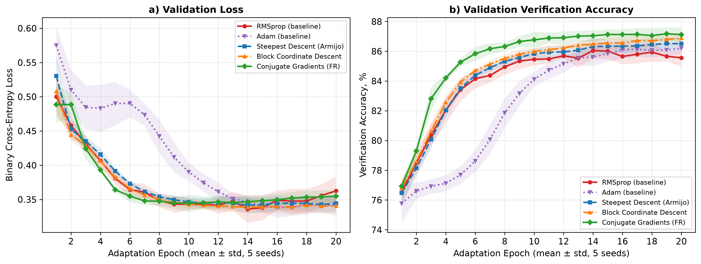
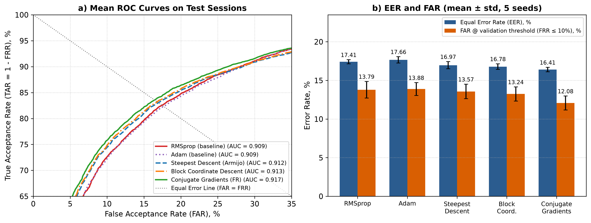

# Keystroke Drift Optimizers

[](https://www.python.org/)
[](https://pytorch.org/)
[](LICENSE)
[](https://mtuci.ru/science/nir_students/tivs/)

> **Reference code and benchmark implementation for the paper:**  
> *«Адаптивное обучение нейросетевых моделей непрерывной поведенческой аутентификации пользователей на основе методов градиентной оптимизации первого порядка»*  
> *(Adaptive Training of Continuous Behavioral Authentication Neural Models Based on First-Order Gradient Optimization Methods)*  
> **Author:** Ilsaf T. Sharibzhanov (Шарибжанов Илсаф Тагирович), MTUCI, Moscow, Russia  
> **Scientific Advisor:** Stanislav S. Zvezhinsky (Звежинский Станислав Сигизмундович), Dr. Sci. (Eng.), Prof., Dept. of Information Security, MTUCI  
> **Proceedings:** International Scientific and Technical Forum *«Telecommunications and Computing Systems — 2026»* (TiVS-2026, MTUCI), Section 3: Information Security (indexed in RINC / РИНЦ).

---

## 1. Problem Statement & Motivation

In continuous behavioral authentication systems (aligned with Zero Trust Architecture, **NIST SP 800-207**, and **GOST R 70262.1–2022**), user keystroke dynamics naturally drift over time (**Concept Drift**) due to operator fatigue, circadian rhythms, or hardware keyboard changes:

$$
P_t(\mathbf{x}, y) \neq P_0(\mathbf{x}, y)
$$

When performing adaptive model fine-tuning on small session batches ($`N \approx 20 \dots 50`$ repetitions) from a pre-trained base model $`\mathbf{w}_0`$ under identical Tikhonov $`L_2`$ regularization ($`\lambda = 0.009`$), standard stochastic optimizers with coordinate-wise gradient scaling (**RMSprop**, **Adam**) suffer from gradient distortion:

$$
\mathbf{w}_{k+1} = \mathbf{w}_k - \frac{\eta}{\sqrt{\mathbb{E}[\mathbf{g}_k^2] + \varepsilon}} \odot \mathbf{g}_k
$$

Dividing each partial derivative by running root-mean-square averages artificially amplifies low-amplitude jitter across noisy coordinates, causing catastrophic forgetting and degrading verification accuracy on delayed sessions (`Sessions 5–8`).

To preserve the true gradient geometry during session fine-tuning while guaranteeing monotonic decrease of the regularized objective, this repository investigates and benchmarks three deterministic first-order optimization schemes equipped with **Armijo backtracking line search**:

### 1.1. Steepest Descent with Armijo Line Search
Updates parameters strictly along the full negative Euclidean gradient $`\mathbf{p}_k = -\mathbf{g}_k`$:

$$
\mathbf{w}_{k+1} = \mathbf{w}_k + \alpha_k \mathbf{p}_k
$$

where step size $`\alpha_k > 0`$ is found via backtracking line search ($`\alpha \leftarrow \rho \alpha`$, $`\rho = 0.5`$) satisfying the Armijo condition of sufficient decrease:

$$
\mathcal{L}(\mathbf{w}_k + \alpha_k \mathbf{p}_k) \le \mathcal{L}(\mathbf{w}_k) + c \, \alpha_k \, \mathbf{g}_k^\top \mathbf{p}_k, \quad c = 10^{-4}
$$

If no step satisfies the condition within maximum iterations, $`\alpha_k = 0`$ and parameter state $`\mathbf{w}_k`$ is restored intact (no unverified update is ever applied).

### 1.2. Layer-Wise Gauss–Seidel Block Coordinate Descent (BCD)
Decomposes network parameters into $`B = 3`$ topological layer blocks $`\mathbf{w} = [(\mathbf{W}_1, \mathbf{b}_1), (\mathbf{W}_2, \mathbf{b}_2), (\mathbf{W}_3, \mathbf{b}_3)]`$, performing sequential block-wise updates:

$$
\mathbf{w}_{k+1}^{(b)} = \mathbf{w}_k^{(b)} - \alpha_k^{(b)} \nabla_{\mathbf{w}^{(b)}} \mathcal{L}(\mathbf{w}_k^{(1)}, \dots, \mathbf{w}_k^{(b)}, \dots, \mathbf{w}_k^{(B)})
$$

with individual per-layer Armijo line search $`\alpha_k^{(b)}`$ for selective layer adaptation.

### 1.3. Nonlinear Conjugate Gradients (Fletcher–Reeves, FR-CG)
Maintains search momentum along conjugate gradient directions:

$$
\mathbf{p}_k = -\mathbf{g}_k + \beta_k^{\text{FR}} \mathbf{p}_{k-1}, \quad \beta_k^{\text{FR}} = \frac{\|\mathbf{g}_k\|_2^2}{\|\mathbf{g}_{k-1}\|_2^2 + \varepsilon}
$$

with sufficient descent verification ($`\mathbf{g}_k^\top \mathbf{p}_k < 0`$), automatic fallback to $`-\mathbf{g}_k`$ upon non-descent directions, and periodic restarts every $`R = 4`$ steps.

---

## 2. Strictly Causal Experimental Protocol & Feature Engineering

Experiments are conducted on the **CMU Keystroke Dynamics Benchmark** (`DSL-StrongPasswordData.csv`, Killourhy & Maxion, 2009), comprising **20,400** typing samples of the 10-character strong password `.tie5Roanl` across **51 subjects** (8 sessions per subject, 50 repetitions per session).

### 2.1. Chronological Split, Stratified Sampling, and Causal Standardization
To prevent any temporal lookahead or distribution mismatch between genuine and impostor classes:

- **Stage 1 — Initial Registration & Base Model Pre-training (`T0`: Sessions 1–4, rep ≤ 20, `N_pretrain = 8,160`)**:
  - Each subject's individual reference template $`(\boldsymbol{\mu}_u, \boldsymbol{\sigma}_u)`$ and the base pre-training pool (80 genuine + 80 impostor samples per subject) are computed **exclusively** from initial registration repetitions (rep ≤ 20) of Sessions 1–4.
  - Pre-training features are standardized using `scaler_pre`, fit **strictly** on `pretrain` (rep ≤ 20, zero statistics from adaptation, validation, or test splits).
  - The shared base neural network $`\mathbf{w}_0`$ is pre-trained on `pretrain`. All five compared optimizers start adaptation from this **exact same** `state_dict` $`\mathbf{w}_0`$.
- **Stage 2 — Session Adaptation / Fine-Tuning (`T1`: Sessions 1–4, 21 ≤ rep ≤ 35, `N_train = 6,120`)**:
  - 60 genuine + 60 impostor samples per subject (15 per session).
  - Features for adaptation, validation, and testing are standardized using `scaler_adapt`, fit strictly on cumulative historical data available up to adaptation (Sessions 1–4, rep ≤ 35).
- **Stage 3 — Intermediate Drift Validation (`T2`: Sessions 5–6, 21 ≤ rep ≤ 50, `N_val = 6,120`)**:
  - Used for monitoring convergence dynamics and calibrating the fixed operating threshold $`\tau^*`$ where validation False Rejection Rate satisfies $`\text{FRR}_{\text{val}} \le 10\%`$.
- **Stage 4 — Delayed Drift Testing (`T3`: Sessions 7–8, 21 ≤ rep ≤ 50, `N_test = 6,120`)**:
  - Final evaluation on the most temporally distant sessions (`Sessions 7–8`), including independent evaluation of FAR at the validation-calibrated operating threshold $`\tau^*`$ (`FAR @ Val FRR=10%`).
- **Session & Repetition Stratified Impostor Sampling**:
  - In every split (`pretrain`, `train`, `val`, `test`), impostor observations ($`y = 0`$) are sampled from other subjects ($`u' \neq u`$) **stratified by `sessionIndex`** and restricted to the **exact same repetition range (`rep`)** as genuine observations ($`y = 1`$).

### 2.2. Intra-Group Biometric Feature Space ($D = 338$)
The 31 raw timing columns are validated and ordered into three physically homogeneous blocks: **11 Hold times** (H1…H11), **10 Down-Down latencies** (DD1…DD10), and **10 Up-Down flight times** (UD1…UD10). All finite differences and adjacent products are computed **strictly inside each homogeneous group** without cyclic wrap-around (`np.roll` is never used):

| Feature Group | Dim | Mathematical Definition |
| :--- | :---: | :--- |
| 1. Relative rhythmic timings | 31 | $`r_k = x_k / T_{\text{DD}}`$, where $`T_{\text{DD}} = \sum_{i=1}^{10} \text{DD}_{i,i+1}`$ is total inter-key press span |
| 2. Unsigned rhythm z-deviations | 31 | $`z_{\text{rhy}, k} = \lvert r_k - \mu_{r, k} \rvert / \sigma_{r, k}`$ against subject enrollment template |
| 3. Unsigned raw timing z-deviations | 31 | $`z_{\text{raw}, k} = \lvert x_k - \mu_{x, k} \rvert / \sigma_{x, k}`$ against subject enrollment template |
| 4. Rhythm-dominant combined deviations | 31 | $`z_{\text{comb}, k} = 0.20\,z_{\text{raw}, k} + 0.80\,z_{\text{rhy}, k}`$ |
| 5. Clipped quadratic rhythm deviations | 31 | $`\min(z_{\text{rhy}, k}^2,\,16.0)`$ |
| 6. Clipped quadratic combined deviations | 31 | $`\min(z_{\text{comb}, k}^2,\,16.0)`$ |
| 7. Intra-group adjacent products | 31 | Within H (10+1 mean), DD (9+1 mean), and UD (9+1 mean) separately |
| 8. Intra-digraph deviation couplings | 31 | $`z_{\text{H},i} z_{\text{UD},i,i+1}`$ (10), $`z_{\text{H},i+1} z_{\text{DD},i,i+1}`$ (10), $`z_{\text{DD},i,i+1} z_{\text{UD},i,i+1}`$ (10) + mean (1) |
| 9. Signed session drift deviations | 31 | $`(x_k - \mu_{x, k}^{(s_1)}) / \sigma_{x, k}`$ relative to initial Session 1 baseline |
| 10. Intra-group first differences | 31 | $`\Delta \text{H}_i`$ (10+1 norm), $`\Delta \text{DD}_i`$ (9+1 norm), $`\Delta \text{UD}_i`$ (9+1 norm) without crossing group boundaries |
| 11. Relative hold-time deviations | 11 | $`\lvert h_i - \mu_{h, i} \rvert / \sigma_{h, i}`$, where normalized hold time $`h_i = H_i / \text{mean}(H)`$ |
| 12. Key-rollover indicators | 10 | Binary indicator $`I(\text{UD}_{i,i+1} < 0)`$ for key rollover (press before previous release) |
| 13. Statistical summary norms | 7 | Summary norms: mean, $`L_2`$-norm, and 75th percentile of absolute deviations |
| **Total** | **338** | Strictly causal, target-independent biometric representation |

### 2.3. Neural Network Architecture & Computational Budget Accounting
- **Classifier (`BiometricMLP`)**: `338 -> 96 (ELU) -> 48 (ELU) -> 1 (Logits / Sigmoid)`, comprising $`m = 37\,249`$ trainable parameters partitioned into $`B = 3`$ topological layer blocks.
- **Unified Objective Function**: Numerically stable binary cross-entropy on logits (`BCEWithLogitsLoss`) with identical Tikhonov $`L_2`$ weight decay ($`\lambda = 0.009`$) across **all five** optimizers:

$$
\mathcal{L}(\mathbf{w}) = \mathcal{L}_{\text{BCE}}(\mathbf{w}) + \frac{\lambda}{2} \|\mathbf{w}\|_2^2
$$

- **Full-Network Parameter Sweeps vs. Gradient Evaluations (20 Adaptation Epochs)**:
  - **RMSprop** & **Adam**: 4 shuffled mini-batches per epoch (`batch_size = 1530`, i.e., 1 full pass over `N_train = 6,120` samples per epoch) $\Rightarrow$ **80 mini-batch gradient evaluations** over 20 epochs.
  - **Steepest Descent (Armijo)** & **Fletcher–Reeves CG**: 4 full-batch steps per epoch $\Rightarrow$ **80 full-batch gradient evaluations** over 20 epochs.
  - **Block Coordinate Descent (BCD)**: 4 Gauss–Seidel sweeps per epoch over the $`B = 3`$ layer blocks (12 partial block-gradient evaluations per epoch) $\Rightarrow$ **240 block-gradient evaluations** (80 full-network sweeps) over 20 epochs.

---

## 3. Experimental Results

### 3.1. Single-Seed Benchmark (seed = 42, 20 Adaptation Epochs, λ = 0.009)

| Optimization Method | Grad Evals | Train Loss | Train Acc, % | Val Loss | Val Acc, % | Test Loss | Test Acc, % | Pooled EER, % | Per-User EER, % | FAR @ 0.5, % | FAR @ Val FRR=10%, % | ROC AUC | Epoch Time, ms |
| :--- | :---: | :---: | :---: | :---: | :---: | :---: | :---: | :---: | :---: | :---: | :---: | :---: | :---: |
| **RMSprop (baseline)** | 80 (mini) | 0.1322 | 95.65 | 0.3384 | 86.44 | 0.5587 | 79.38 | 16.63 | 13.94 ± 9.04 | 5.78 | 13.20 | 0.9162 | 22.4 |
| **Adam (baseline)** | 80 (mini) | 0.1334 | 95.41 | 0.3269 | 86.63 | 0.5355 | 79.85 | 17.04 | 13.82 ± 8.70 | 6.80 | 13.79 | 0.9143 | 26.0 |
| **Steepest Descent (Armijo)** | 80 (full) | 0.1294 | 95.29 | **0.3205** | 87.22 | **0.5074** | 81.75 | 16.11 | 13.30 ± 9.00 | 6.93 | 13.30 | 0.9208 | 69.1 |
| **Block Coordinate Descent** | 240 (block) | 0.1257 | 95.64 | 0.3274 | 86.99 | 0.5234 | 81.27 | 16.09 | 13.43 ± 8.87 | 6.34 | 13.30 | 0.9203 | 113.0 |
| **Conjugate Gradients (FR)** | 80 (full) | **0.0904** | **97.22** | 0.3298 | **87.88** | 0.5430 | **81.78** | **15.59** | **12.83 ± 8.63** | 6.05 | **11.86** | **0.9262** | 69.7 |

### 3.2. Chronological Per-Session EER Progression (`Sessions 5 -> 6 -> 7 -> 8`, `seed = 42`)

| Optimization Method | Session 5 (Val), % | Session 6 (Val), % | Session 7 (Test), % | Session 8 (Test), % | Drift Degradation (S8 − S5), pp |
| :--- | :---: | :---: | :---: | :---: | :---: |
| **RMSprop (baseline)** | 10.98 | 12.84 | 16.54 | 17.12 | +6.14 |
| **Adam (baseline)** | 11.27 | 13.14 | 16.73 | 17.39 | +6.12 |
| **Steepest Descent (Armijo)** | 11.34 | 12.61 | 15.72 | 16.60 | +5.26 |
| **Block Coordinate Descent** | 10.88 | 12.55 | 15.65 | 16.41 | +5.53 |
| **Conjugate Gradients (FR)** | **10.13** | **11.93** | **15.10** | **15.59** | **+5.46** |

### 3.3. Multi-Seed Statistical Evaluation (Seeds 42–46, Student-t 95% CI, df = 4)

Confidence intervals are calculated using the two-tailed Student-$t$ distribution with $`df = 4`$ degrees of freedom ($`t_{0.975, 4} = 2.7764`$):

| Optimization Method | Pooled EER, % (mean ± std [95% CI]) | Per-User EER, % (mean ± std [95% CI]) | FAR @ 0.5, % (mean ± std) | FAR @ Val FRR=10%, % (mean ± std) | ROC AUC (mean ± std) |
| :--- | :---: | :---: | :---: | :---: | :---: |
| **RMSprop (baseline)** | 17.27 ± 0.37 [±0.46] | 14.71 ± 0.60 [±0.74] | 6.12 ± 0.53 | 14.77 ± 1.56 | 0.9113 ± 0.0033 |
| **Adam (baseline)** | 17.73 ± 0.68 [±0.84] | 14.81 ± 0.78 [±0.97] | 7.33 ± 0.42 | 15.53 ± 1.72 | 0.9092 ± 0.0048 |
| **Steepest Descent (Armijo)** | 17.17 ± 0.86 [±1.07] | 14.75 ± 0.89 [±1.10] | 6.97 ± 0.36 | 14.83 ± 1.73 | 0.9119 ± 0.0062 |
| **Block Coordinate Descent** | 17.19 ± 0.91 [±1.13] | 14.60 ± 0.85 [±1.06] | 6.81 ± 0.36 | 14.72 ± 1.66 | 0.9120 ± 0.0063 |
| **Conjugate Gradients (FR)** | **16.54 ± 0.84 [±1.05]** | **13.89 ± 0.66 [±0.81]** | 6.25 ± 0.38 | **13.73 ± 1.64** | **0.9174 ± 0.0054** |

### 3.4. Paired Seed-by-Seed Differences vs. Fletcher–Reeves CG

Because all methods share the exact same data splits and pre-trained initialization $`\mathbf{w}_0`$ within each seed $`i \in \{42, 43, 44, 45, 46\}`$, paired differences isolate optimizer variance from dataset sampling variance:

| Baseline Method vs. FR-CG | Mean Paired ΔEER, pp | Paired Std $s_d$, pp | Student-t 95% CI (df=4), pp | Paired t-statistic | Mean Paired ΔUser EER, pp |
| :--- | :---: | :---: | :---: | :---: | :---: |
| **Adam − FR-CG** | **+1.19** | 0.43 | ±0.53 ([+0.66, +1.72]) | t = 6.19 | **+0.92** |
| **RMSprop − FR-CG** | **+0.73** | 0.69 | ±0.85 ([-0.12, +1.58]) | t = 2.36 | **+0.82** |
| **Block Coordinate Descent − FR-CG** | **+0.64** | 0.45 | ±0.56 ([+0.08, +1.20]) | t = 3.22 | **+0.71** |
| **Steepest Descent − FR-CG** | **+0.63** | 0.31 | ±0.39 ([+0.24, +1.02]) | t = 4.55 | **+0.85** |

---

## 4. Convergence & Biometric Error Visualizations

### Figure 1: Validation Convergence Dynamics


### Figure 2: ROC Curves & Biometric Verification Errors on Delayed Drift Sessions


---

## 5. Repository Structure & Reproducibility

```text
keystroke-drift-optimizers/
├── data/
│   └── DSL-StrongPasswordData.csv   # CMU Keystroke Dynamics Benchmark dataset (20,400 samples)
├── figures/
│   ├── fig1_convergence_loss_acc.png
│   └── fig2_roc_and_biometric_errors.png
├── src/
│   ├── __init__.py
│   ├── dataset.py                   # Schema validation, causal splits, 338-dim intra-group features
│   ├── models.py                    # BiometricMLP (338->96->48->1) with 3 topological layer blocks
│   ├── optimizers.py                # Pre-training, Armijo line search, 3-block BCD, FR-CG, RMSprop, Adam
│   └── metrics.py                   # Pooled/Per-User/Per-Session EER, Student-t CI, val-calibrated FAR@FRR10
├── tests/
│   └── test_pipeline.py             # Automated unit tests for mathematical & causal invariants
├── run_experiments.py               # Main CLI runner (single-seed + 5-seed paired statistical suite)
├── experiment_results.json          # Saved metrics, ROC curves, and 5-seed paired statistics
├── requirements.txt
└── LICENSE
```

### Quick Start
```bash
pip install -r requirements.txt

# Run automated unit test suite (6 tests)
pytest -v

# Run full benchmark including Adam and 5-seed paired statistical evaluation
python run_experiments.py --include-adam --multi-seed
```

---

## 📖 Citation

If you find this code or research useful, please cite our paper:

```bibtex
@inproceedings{sharibzhanov2026adaptive,
  title     = {Адаптивное обучение нейросетевых моделей непрерывной поведенческой аутентификации пользователей на основе методов градиентной оптимизации первого порядка},
  author    = {Шарибжанов, И. Т. and Звежинский, С. С.},
  booktitle = {Труды Международного научно-технического форума <<Телекоммуникационные и вычислительные системы -- 2026>> (ТиВС-2026)},
  year      = {2026},
  address   = {Москва},
  publisher = {МТУСИ},
  note      = {Секция 3: Информационная безопасность}
}
```

---

## 📄 License

This project is licensed under the terms of the [MIT License](LICENSE).
